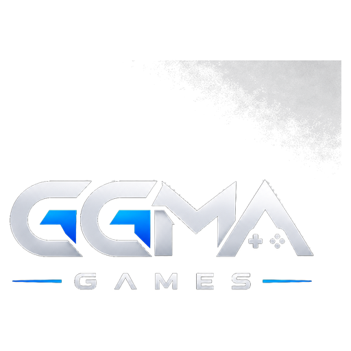

  

<h1 align="center">GGAM Games</h1>

  <strong>Mobil oyun stüdyosu</strong> 
  Klasik masa &amp; kart oyunları · Bulmaca · Aksiyon 
  iOS &amp; Android

  
  
  

---

## Hakkımızda

GGAM Games, App Store ve Google Play için üretilen mobil oyunlar geliştiren bir stüdyodur. Portföyümüzde online çok oyunculu klasikler, kısa oturumlu bulmacalar ve aksiyon başlıkları yer alır.

Odak alanlarımız:

- **Klasik oyunlar** — okey, tavla, satranç, batak, pişti, uno ve benzeri
- **Bulmaca** — sayı, blok ve ok mantığı odaklı casual deneyimler
- **Aksiyon &amp; arcade** — hızlı tempolu, dokunmatik kontrollü oyunlar

---

## Portföy

| Oyun | Tür | Repo |
|------|-----|------|
| 101 Kral Okey Online | Online masa | [`101-kral-okey-online`](https://github.com/GGAM-Games/101-kral-okey-online) |
| Tavla Online | Online masa | [`tavla-online`](https://github.com/GGAM-Games/tavla-online) |
| Satranç Online | Online masa | [`santranc-online`](https://github.com/GGAM-Games/santranc-online) |
| UNO | Kart | [`uno-game`](https://github.com/GGAM-Games/uno-game) |
| Pis Yedili | Kart | [`pis7-online-game`](https://github.com/GGAM-Games/pis7-online-game) |
| Batak | Kart | [`batak`](https://github.com/GGAM-Games/batak) |
| Pişti | Kart | [`pisti`](https://github.com/GGAM-Games/pisti) |
| Klaro Puzzle | Bulmaca | [`klaro-puzzle`](https://github.com/GGAM-Games/klaro-puzzle) |
| CrossMath | Bulmaca | [`crossmath-number-puzzle`](https://github.com/GGAM-Games/crossmath-number-puzzle) |
| ArrowGO | Bulmaca | [`arrowgo-ok-bulmaca`](https://github.com/GGAM-Games/arrowgo-ok-bulmaca) |
| Let the Number Fall | Bulmaca | [`let-the-number-fall`](https://github.com/GGAM-Games/let-the-number-fall) |
| Mind Labyrinth | Bulmaca | [`mind-labyrinth`](https://github.com/GGAM-Games/mind-labyrinth) |
| Fruit Butcher | Arcade | [`fruit-butcher`](https://github.com/GGAM-Games/fruit-butcher) |
| Zamkır | Casual | [`zambir`](https://github.com/GGAM-Games/zambir) |
| Tank 1990 | Arcade | [`tank-1990`](https://github.com/GGAM-Games/tank-1990) |
| Echoes of the Oasis | Simülasyon | [`echoes-of-the-oasis--game`](https://github.com/GGAM-Games/echoes-of-the-oasis--game) |
| World State Online | Strateji | [`worlstate-online`](https://github.com/GGAM-Games/worlstate-online) |
| Air Combat | Aksiyon | [`air-combat`](https://github.com/GGAM-Games/air-combat) |

> Repoların çoğu özel (private) tutulur. Erişim için org üyeliği gerekir.

---

## Teknoloji

| Alan | Araçlar |
|------|---------|
| Mobil istemci | Flutter (Dart), Unity (C#) |
| Backend | .NET, Firebase |
| Dağıtım | App Store Connect, Google Play, Fastlane |
| Marka varlıkları | [`ggma-games-info`](https://github.com/GGAM-Games/ggma-games-info) |

---

## Marka

Logo paketleri ve stüdyo görselleri:

[`GGAM-Games/ggma-games-info`](https://github.com/GGAM-Games/ggma-games-info)

  

---

## İletişim

- **GitHub:** [github.com/GGAM-Games](https://github.com/GGAM-Games)
- **Konum:** Türkiye

  © GGAM Games — All rights reserved.

