

  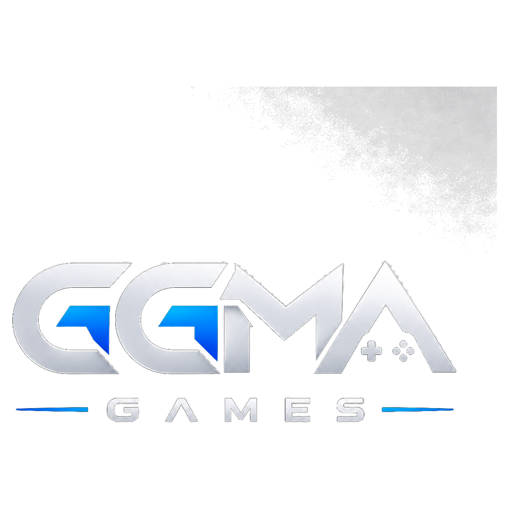

<h1 align="center">GGAM Games</h1>

  <strong>Mobile Game Studio</strong> 
  Klasik masa &amp; kart · Bulmaca · Aksiyon 
  <em>iOS &amp; Android</em>

  
  
  

---

## About

GGAM Games develops and publishes mobile games for the App Store and Google Play. Our portfolio spans online multiplayer classics, short-session puzzles, and touch-first action titles.

| Focus | Examples |
|:------|:---------|
| **Classic** | Okey, tavla, chess, batak, pişti, UNO |
| **Puzzle** | Number, block, and arrow logic games |
| **Action & Arcade** | Fast sessions, touch controls |

---

## Portfolio

  <a href="https://github.com/GGAM-Games/101-kral-okey-online">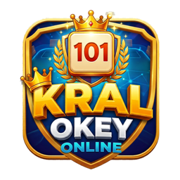</a>
  &nbsp;
  <a href="https://github.com/GGAM-Games/tavla-online">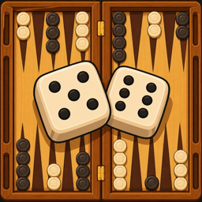</a>
  &nbsp;
  
  &nbsp;
  <a href="https://github.com/GGAM-Games/uno-game">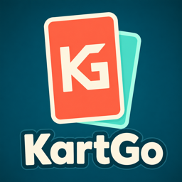</a>
  &nbsp;
  <a href="https://github.com/GGAM-Games/pis7-online-game">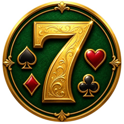</a>
  &nbsp;
  <a href="https://github.com/GGAM-Games/klaro-puzzle">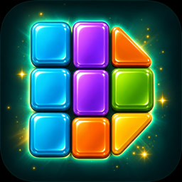</a>

  <a href="https://github.com/GGAM-Games/crossmath-number-puzzle">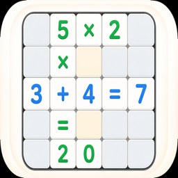</a>
  &nbsp;
  <a href="https://github.com/GGAM-Games/arrowgo-ok-bulmaca">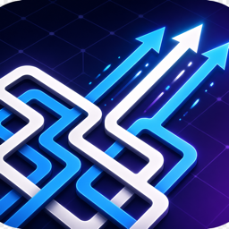</a>
  &nbsp;
  <a href="https://github.com/GGAM-Games/let-the-number-fall">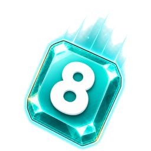</a>
  &nbsp;
  
  &nbsp;
  <a href="https://github.com/GGAM-Games/fruit-butcher">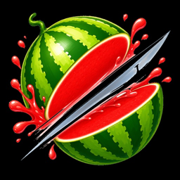</a>
  &nbsp;
  <a href="https://github.com/GGAM-Games/zambir">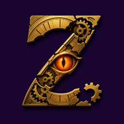</a>

  <a href="https://github.com/GGAM-Games/tank-1990">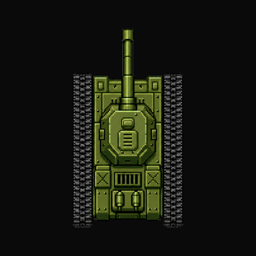</a>
  &nbsp;
  <a href="https://github.com/GGAM-Games/echoes-of-the-oasis--game">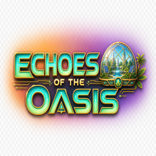</a>
  &nbsp;
  <a href="https://github.com/GGAM-Games/worlstate-online">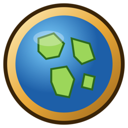</a>
  &nbsp;
  <a href="https://github.com/GGAM-Games/air-combat">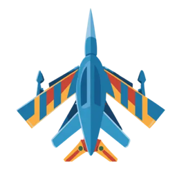</a>

| | Title | Genre | Repository |
|:-:|:------|:------|:-----------|
|  | 101 Kral Okey Online | Online table | [`101-kral-okey-online`](https://github.com/GGAM-Games/101-kral-okey-online) |
|  | Tavla Online | Online table | [`tavla-online`](https://github.com/GGAM-Games/tavla-online) |
|  | Satranç Online | Online table | [`santranc-online`](https://github.com/GGAM-Games/santranc-online) |
|  | UNO | Cards | [`uno-game`](https://github.com/GGAM-Games/uno-game) |
|  | Pis Yedili | Cards | [`pis7-online-game`](https://github.com/GGAM-Games/pis7-online-game) |
| | Batak | Cards | [`batak`](https://github.com/GGAM-Games/batak) |
| | Pişti | Cards | [`pisti`](https://github.com/GGAM-Games/pisti) |
|  | Klaro Puzzle | Puzzle | [`klaro-puzzle`](https://github.com/GGAM-Games/klaro-puzzle) |
|  | CrossMath | Puzzle | [`crossmath-number-puzzle`](https://github.com/GGAM-Games/crossmath-number-puzzle) |
|  | ArrowGO | Puzzle | [`arrowgo-ok-bulmaca`](https://github.com/GGAM-Games/arrowgo-ok-bulmaca) |
|  | Let the Number Fall | Puzzle | [`let-the-number-fall`](https://github.com/GGAM-Games/let-the-number-fall) |
|  | Mind Labyrinth | Puzzle | [`mind-labyrinth`](https://github.com/GGAM-Games/mind-labyrinth) |
|  | Fruit Butcher | Arcade | [`fruit-butcher`](https://github.com/GGAM-Games/fruit-butcher) |
|  | Zamkır | Casual | [`zambir`](https://github.com/GGAM-Games/zambir) |
|  | Tank 1990 | Arcade | [`tank-1990`](https://github.com/GGAM-Games/tank-1990) |
|  | Echoes of the Oasis | Simulation | [`echoes-of-the-oasis--game`](https://github.com/GGAM-Games/echoes-of-the-oasis--game) |
|  | World State Online | Strategy | [`worlstate-online`](https://github.com/GGAM-Games/worlstate-online) |
|  | Air Combat | Action | [`air-combat`](https://github.com/GGAM-Games/air-combat) |

> Most game repositories are **private**. Organization membership is required for access.

---

## Technology

| Layer | Tools |
|:------|:------|
| Client | Flutter (Dart), Unity (C#) |
| Backend | .NET, Firebase |
| Release | App Store Connect, Google Play, Fastlane |
| Brand | [`ggma-games-info`](https://github.com/GGAM-Games/ggma-games-info) |

---

## Brand assets

Studio logos and packaging files live in:

**[`GGAM-Games/ggma-games-info`](https://github.com/GGAM-Games/ggma-games-info)**

  

---

## Contact

| | |
|:--|:--|
| GitHub | [github.com/GGAM-Games](https://github.com/GGAM-Games) |
| Location | Türkiye |

 

  © GGAM Games. All rights reserved.

